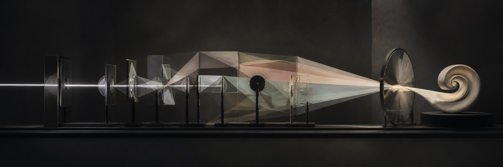

  

<h1 align="center">AgentKiller45</h1>

  Had I not seen the Sun,I could have borne the shade.But Light a newer WildernessMy Wilderness has made.

---

### A point of view

Intelligence do not judge for us.

An agent can search a wider space, execute more paths, and surface possibilities that a person may never reach alone. But more possibilities do not automatically produce a better direction. Why Human can evolve so fast in the long history, because we always select the most effective way by our intelligence.

I am interested in the boundary between the two:

- what should be delegated, and what should remain a human responsibility;
- how autonomy can expand capability without dissolving accountability;
- how systems can remain understandable while becoming more capable;
- how tools can challenge our thinking without quietly replacing it.

### How I think about future of AI 

Agents are not substitutes for intent. They are instruments for extending it.

The most valuable systems do more than complete a task. They make exploration cheaper, consequences more visible, and revision more natural. They help a person encounter more possibilities while preserving the ability to question, refuse, and choose.

That requires more than better models. It requires thoughtful boundaries, observable actions, reversible decisions, and a clear place for human judgment.

